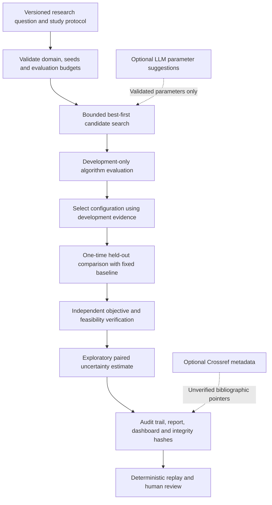

<div align="center">
  

  # REI Scientist

  **Evidence-first experimental research, from falsifiable hypotheses to reproducible results.**

  An offline-first, independently implemented research engine by **Rootcastle Engineering & Innovation**.

  [](https://github.com/rootcastleco/REI-Scientist/actions/workflows/ci.yml)
  
  
  [](LICENSE)

  [Quick start](#quick-start) &nbsp;|&nbsp; [Methodology](#methodology) &nbsp;|&nbsp; [Reproducibility](#reproducibility-and-evidence) &nbsp;|&nbsp; [Security](#security-and-responsible-research) &nbsp;|&nbsp; [Roadmap](#roadmap)
</div>

---

## Why REI Scientist?

An automated research system should be evaluated by the quality of its **evidence**, not by how convincingly it writes a paper. REI Scientist provides a small, inspectable foundation for investigating numerical optimization hypotheses under predeclared resource limits and independent verification.

Given a versioned study specification, the engine searches registered algorithm configurations on *development seeds*, selects a candidate, performs one held-out evaluation against a fixed baseline, independently checks the numerical evidence, and emits machine-readable artifacts alongside a human-readable report.

> **Project status:** v0.1.0 is a research-engine prototype for controlled synthetic optimization studies. It is **not** a general-purpose autonomous scientist, a peer-reviewed discovery, or an automated manuscript submission system. The optional remote-LLM and literature adapters have not been live-validated against external services.

## Capabilities and scope

| Capability | v0.1.0 status | Notes |
|:---|:---:|:---|
| Falsifiable study protocol | **Implemented** | Validated JSON schema, hypothesis, baseline, budgets and success threshold |
| Bounded search | **Implemented** | Best-first exploration over approved methods and parameters |
| Numerical algorithms | **Implemented** | Random search, hill climbing and simulated annealing |
| Synthetic benchmarks | **Implemented** | Sphere, Rastrigin, Rosenbrock and Ackley |
| Leakage control | **Implemented** | Distinct development and held-out seeds |
| Independent verification | **Implemented** | Feasibility checks, objective recomputation, trace and budget audits |
| Reproducible artifacts | **Implemented** | Reports, structured events, JSON manifests, source fingerprints and replay |
| Human-readable visualizations | **Implemented** | Self-contained offline HTML experiment dashboard |
| LLM-assisted ideas and parameter proposals | **Optional / not live-tested** | Opt-in, strict JSON, registered methods only; no generated-code execution |
| Bibliographic lookup | **Optional / not live-tested** | Crossref metadata, **not** verified full-text evidence |
| Arbitrary ML training, lab equipment control or paper submission | **Not implemented** | Explicitly outside v0.1.0 |

## Quick start

**Requirements:** Python 3.11+ and a supported Linux, macOS or Windows environment. No API key or GPU is needed for the offline path.

```bash
# Clone and install the development package.
git clone https://github.com/rootcastleco/REI-Scientist.git
cd REI-Scientist
python -m pip install -e .

# Run a supplied, fully offline numerical study.
rei-scientist run examples/sphere_study.json --out runs/sphere-001

# Independently verify the saved experiment, including replay.
rei-scientist verify runs/sphere-001

# Read the report or open the self-contained dashboard.
cat runs/sphere-001/report.md
```

Create and modify a new study:

```bash
rei-scientist init \
  --benchmark rastrigin \
  --study-id rastrigin-exploration \
  --out my-study.json

# Review the hypothesis and controls before executing the study.
rei-scientist run my-study.json --out runs/rastrigin-exploration
rei-scientist verify runs/rastrigin-exploration
```

The program **refuses to overwrite existing experiment directories or study files**. Choose a new output path for each run. You can inspect the complete examples in [`examples/`](examples/) and the two committed reference runs in [`demo/`](demo/).

## Methodology



### Experimental design

1. **Predeclare the question.** A study records the objective, search domain, hypothesis, evaluation count, methods, random seeds and minimum improvement threshold *before* running the experiment.
2. **Separate selection from assessment.** Configurations are ranked using development seeds; the winner is evaluated against a fixed baseline on disjoint holdout seeds.
3. **Constrain the search.** The engine allows only registered methods and bounded configuration changes. Every objective evaluation contributes to an explicit budget.
4. **Verify independently.** Recorded candidate solutions are checked against a separate reference implementation and against the declared search bounds and evaluation counts.
5. **Preserve provenance.** Each experiment stores a study, results, an event log, a report and a SHA-256 integrity manifest; the `verify` command re-executes the saved experiment.

**Statistical boundary:** The paired percentile bootstrap is exploratory. A positive interval from a small set of holdout seeds is *not* a formal claim of algorithmic dominance or generalization to different benchmarks, hardware or field data.

### Study example

The following is an abbreviated protocol; the runnable file is [`examples/sphere_study.json`](examples/sphere_study.json).

```json
{
  "schema_version": "1.0",
  "study_id": "sphere-optimizer-pilot",
  "benchmark": "sphere",
  "dimension": 2,
  "bounds": [-5.0, 5.0],
  "evaluation_budget": 120,
  "candidate_budget": 8,
  "max_depth": 2,
  "dev_seeds": [11, 23, 37],
  "test_seeds": [101, 103, 107, 109, 113],
  "minimum_improvement_pct": 5.0,
  "methods": ["random_search", "hill_climb", "simulated_annealing"]
}
```

A complete study also includes `question`, `hypothesis` and `source_note`. The parser validates all required fields.

## Reproducibility and evidence

Each successful run writes:

| Artifact | Role |
|---|---|
| `study.json` | Validated, versioned experiment definition |
| `results.json` | Candidate configurations, development metrics and held-out evidence |
| `events.jsonl` | Structured experimental and selection events |
| `manifest.json` | File hashes, source fingerprint, runtime information and evaluation accounting |
| `report.md` | Protocol, measured results, limitations and a PASS/FAIL/NOT VERIFIED assessment |
| `dashboard.html` | Offline, self-contained results viewer |

### Reference pilot: Sphere

A locally verified, two-dimensional synthetic Sphere study reported:

| Measure | Observed value |
|---|---:|
| Total function evaluations | 4,440 |
| Baseline mean on five holdout seeds | 0.44453352 |
| Selected configuration mean | 0.02317467 |
| Relative reduction in mean objective | 94.787% |
| Paired holdout wins | 4 of 5 |
| Paired-bootstrap 95% interval for absolute improvement | [0.20663, 0.60995] |

**Interpretation:** This is a positive result on one specified synthetic benchmark, not evidence of an improvement on industrial datasets or an independently replicated scientific discovery. See the [full example report](demo/sphere-001/report.md), [experiment manifest](demo/sphere-001/manifest.json), and [verification record](docs/verification-results.md). The separate Rastrigin pilot is also included under [`demo/rastrigin-001/`](demo/rastrigin-001/).

### Run tests

```bash
python -m unittest discover -s tests -v
python -m compileall -q src tests
```

The current test suite contains **36 offline tests** covering algorithms, protocol validation, artifact integrity, network guards, search and independent replay. These tests passed locally on Python 3.13; CI is configured to run against Python 3.11, 3.12 and 3.13, but passing CI must be confirmed from the workflow results. Live provider integration, a Docker runtime smoke test, external replication and penetration testing remain **NOT VERIFIED**.

## Optional external research assistance

REI Scientist remains offline unless the operator explicitly requests a network-dependent capability. The optional OpenAI-compatible provider adapter allows strictly validated **parameter suggestions** and **hypothesis wording**; it does not execute generated Python, shell commands or arbitrary model-supplied programs.

```bash
export REI_SCIENTIST_API_KEY="YOUR_PROVIDER_API_KEY"
export REI_SCIENTIST_BASE_URL="https://api.openai.com/v1"
export REI_SCIENTIST_MODEL="YOUR_SUPPORTED_MODEL"

rei-scientist run examples/sphere_study.json \
  --llm-proposals \
  --out runs/sphere-assisted

# Optional Crossref metadata lookup (no full-text validation):
rei-scientist run examples/sphere_study.json \
  --literature \
  --out runs/sphere-literature
```

The application restricts provider endpoints to an explicit HTTPS allowlist. An application allowlist is **not** equivalent to a hardened OS/container network policy. API costs, provider availability and model compatibility are not guaranteed by this repository.

## Security and responsible research

- **No model-generated code execution.** Model outputs are parsed as data and checked against approved methods and parameter ranges.
- **Bounded resources.** Studies have hard limits on dimensions, evaluations, candidate counts, search depth and seed counts. For stronger CPU/memory/process limits, run inside an isolated container.
- **Least privilege by default.** No production integrations, equipment control, secret persistence, data harvesting or unattended publication.
- **Tamper detection, not attestation.** SHA-256 file hashes and deterministic replay can detect many accidental modifications, but manifests are not signed and do not establish independently trusted provenance.
- **Human responsibility.** Source verification, model-usage disclosure, statistical review and research-ethics checks are required before public scientific claims.

Read the [threat model and operating controls](SECURITY.md) and [research-integrity criteria](docs/research-integrity.md). The Dockerfile provides a non-root runtime; container hardening and network restrictions are the operator's responsibility.

## Repository layout

```text
.
├── .github/workflows/ci.yml     Offline tests and smoke-test matrix
├── src/rei_scientist/          Protocol, search, solvers, verifier and CLI
├── tests/                      Offline unit, negative and replay tests
├── examples/                   Versioned, executable study configurations
├── demo/                       Captured synthetic pilot evidence and dashboards
├── docs/                       Research integrity and verification summary
├── specs/001-research-engine/   Requirements, architecture and traceability
├── Dockerfile                  Optional non-root container runtime
├── SECURITY.md                 Threat model and operating boundary
└── pyproject.toml              Python packaging and CLI entry point
```

## Roadmap

| Stage | Planned work | Release criterion |
|---|---|---|
| **v0.2** | Approved domain adapters, leakage checks, controlled datasets, cancellation and improved statistical analysis | Repeatable synthetic telemetry or sensor-calibration experiments with independent reference checks |
| **v0.3** | Isolated execution workers, authenticated APIs, budget accounting, richer figure generation and signed provenance | Resource limits, threat-model tests and audit-ready, reproducible experimental artifacts |
| **v1.0** | Domain-specific autonomous study workflows, independently audited baselines and human publication approval gates | Reproducibility on permissioned field datasets, external replication and explicit risk acceptance |

Roadmap items are **plans, not available features**. Integration with REI Track, Magnus Balance or Sofia AI is not included in v0.1.0.

## Origins, licensing and citation

REI Scientist is an **original MIT-licensed implementation** by [Rootcastle Engineering & Innovation](https://rootcastle.com). Its research automation goals are informed by the broader literature, including [The AI Scientist-v2 (Sakana AI)](https://arxiv.org/abs/2504.08066), but this repository does **not** contain Sakana AI Scientist-v2 source code and is not a rebranding of that project. Third-party packages and external projects have their own license terms.

For citation and machine-readable project metadata, see [`CITATION.cff`](CITATION.cff). When publishing work produced with REI Scientist, cite the software version and study artifacts, disclose AI involvement where applicable, and have the scientific claims independently reviewed.

---

<div align="center">
  <small><strong>Rootcastle Engineering & Innovation</strong> &mdash; Design experiments. Preserve evidence. Verify claims.</small>
</div>
